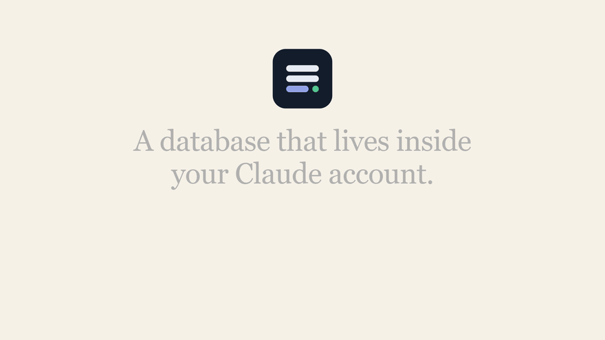

# Rowkeep

A small database that lives inside a Claude account. It is an append-only activity stream,
kept in the document database of a Claude artifact and written by a skill, so there is no
server, no outside service and nothing to administer. On top of the stream it keeps current
records (companies, contacts, deals), follow-ups with due dates, outreach sequences, a
morning brief, and a second copy in a vault.



A 58-second walk-through. The company names in it are invented.

**Status: experimental.** One author, one account, days old. Read "What has and has not been
tested" before relying on it.

Rowkeep is an independent project. It is not made, endorsed or supported by Anthropic.
"Claude" and "Claude Code" are Anthropic's names for its own products.

## Try it

In a claude.ai chat, with nothing else installed:

1. Download [`rowkeep.skill`](https://github.com/cklose2000/rowkeep/releases/latest/download/rowkeep.skill),
   the latest release.
2. In claude.ai open Customize, then Skills, choose Add skill, then Upload skill. Code
   execution must be on.
3. In a new chat, say **set up Rowkeep**. It says what it will make and waits for your yes.

In Claude Code:

```
claude plugin marketplace add cklose2000/rowkeep
claude plugin install rowkeep@rowkeep
```

Then say **set up Rowkeep**. The details are under [Install](#install), and
[docs/REVIEW.md](docs/REVIEW.md) is a fifteen-minute walk-through with sample data.

## What it does

- **Logs what you ask it to.** The assistant records what was done, to what, by whom: a
  decision made, a purchase approved, a call with a client. Turn automatic logging on for
  yourself and it also records a closed list of things as they happen (a version
  published, a file changed in a way that matters, a decision, an approval, a contact with
  a client). On a shared log that choice is each person's own.
- **Keeps history checkable.** Rows are numbered and chained by fingerprint, so a row
  changed or removed by accident, or by anyone who does not then recompute the chain, shows
  up when the whole stream is checked. Someone who can write the log can recompute the
  chain; what shows that is a comparison with a vault they cannot reach. See
  [SECURITY.md](SECURITY.md) for exactly what each check does and does not prove.
- **Answers without SQL.** Counts and totals are kept as each row is sealed, so "how much per
  vendor" is one small read.
- **Keeps records.** Each thing the stream mentions has a current state: a deal's stage, an
  account's owner, the next step and when it is due. Names are matched, so "ALDER EXAMPLE
  Corp." finds the record made for "Alder Example Co" (an invented name, like every sample
  name in this repository), and a near miss is put to you as a question.
- **Runs sequences.** Steps in order, a few days apart, each done once per target: an outreach
  cadence, a renewal run-up. The assistant drafts a step and records it when you say it
  went out. It never sends one.
- **Prepares a morning brief.** A scheduled session lists what is due and drafts the
  messages. It sends nothing and has no mail tool. The brief is stored in the log, where
  everyone the log is shared with can read it. Setup asks separately whether that session
  may also seal your waiting rows, seal your teammates', and copy to the vault, and it
  does only what you said yes to.
- **Keeps a second copy.** A vault artifact holds every row that had been sealed when it was
  last copied to, provided that copy completed. A log can be put back from it, up to that
  row. Comparing the two (`vault-check`, with the whole stream) is what detects a rewritten
  history, and only if the vault is one the person who rewrote the log could not also
  write: a vault you trust, kept unshared. Two artifacts in one account are not an
  independent witness.

## How it works

The assistant talks to the database; one Python script bundled with the skill does the
checking and the arithmetic (standard library only, no network). New rows go to an inbox, one small document each. Sealing gives
them their place in the chain and updates the index, in one all-or-nothing batch. Sealing
and vault copies happen when you ask for them, or in a session you scheduled for them, and
never as a side effect of a question. Any session with edit rights can seal, a chat
included: a chat carries each document by hand, so every document it reads back holds a
checksum that the script verifies, and what it wrote by hand it reads back and compares
with what was planned. The format
is described in [docs/ACTIVITY-STREAM.md](docs/ACTIVITY-STREAM.md). What the assistant is told
to do is in [plugin/skills/rowkeep/SKILL.md](plugin/skills/rowkeep/SKILL.md).

The script needs Python 3.8 or later on the machine the session runs on, and nothing else.
CI runs it on 3.8 and on 3.14. Its launcher (`scripts/rowkeep.sh`) runs the first `python3`
or `python` on the PATH that is 3.8 or later, and says so if there is none.

## Install

1. Get `rowkeep.skill` from this repository's releases, or build it (below).
2. Upload it: in claude.ai open Customize, then Skills, choose Add skill, then Upload skill
   (older layouts have Skills under Settings); code execution must be on. The page takes a
   `.zip` or `.skill` file that includes a `SKILL.md`.
3. Say **set up Rowkeep**, in Claude Code or in a claude.ai chat that can publish artifacts.
   It says what it will make, waits for your yes, makes your log and your vault, and proves
   them with one sealed row.
4. From Claude Code, setup also gives you a second file, `rowkeep-personal.skill`, with
   your log's link and your vault's link written in: upload it in place of the first, and
   never publish it. From a chat there is nothing more to do: a chat finds your log by its
   title, `Rowkeep`. From then on, logging needs a chat that has the artifact database
   tools and access to the log.

Setup from a chat has been run by the author in a real chat; see "What has and has not
been tested" for what that does and does not show. [docs/REVIEW.md](docs/REVIEW.md) is a
fifteen-minute walk-through with sample data. For a team, one person runs setup, shares the
log's page with each of the others by name (the role Contributor for people who log, Editor
only for people who may also seal), leaves general access at "Only people invited", keeps
the vault unshared, and gives the others the log's link or, from Claude Code, a team skill
file that names the log and not the vault (the skill's `setup/SETUP.md` says how). A shared
log has been run once, with two people: "What has and has not been tested" says what that
showed.

## Before you use it

- **It logs only what you ask, unless you say otherwise.** By default the assistant logs
  on request and says so in one line each time. Automatic logging is a choice you turn on
  for yourself; nobody else's choice applies to you. From version 0.7.1 a log's rules let
  nobody but you write the entry that holds your choice, the owner included. That is the
  platform's rule, seen once on a one-person test log and not yet with two accounts; a log
  made earlier keeps the older rule until its owner has it brought up to date
  ([SECURITY.md](SECURITY.md), "Who can do what").
- **There is no way to erase one row.** The workflow has none and the skill never edits a
  row, while the owner and editors of the artifact have the database itself in their
  hands. The skill tells the assistant to keep email addresses, phone numbers and home
  addresses out; it allows names, employers and roles, which are personal data too. Do not
  use it for data someone may have a right to have deleted.
- **The two pages run JavaScript** in the browser of whoever opens them. They read the
  artifact's own database and load nothing from outside.
- **What is kept where, and how to remove it,** is in [PRIVACY.md](PRIVACY.md): the two
  artifacts are not the only place.
- **The credential check is a net, not a guarantee.** It drops fields named like credentials
  and masks text shaped like common tokens. Do not paste secrets and rely on it.
- **It costs usage.** Sealing and the morning brief are sessions like any other.
- **It depends on behaviour Anthropic has not documented.** The database limits and tool
  names here were observed on claude.ai in November 2026 (100 MB and 25,000 documents per
  artifact, 256 KiB per document, 50 writes per batch). Any of it can change.
- **A log holds about 8,000 to 24,000 rows.** The artifact's database stops at 25,000
  documents, and a row takes one document, plus one when it changes a record that has no
  entry yet, plus one when it carries a key against being logged twice. About 100 rows
  have been sealed on real accounts and 5,000 in the tests here; nothing nearer the limit
  has been run. Packing old rows many to a document, as the vault already does, would
  raise the figure and is not built. For a table of hundreds of thousands of rows that
  people edit, use a spreadsheet.
- **Which Claude plans it works on is only partly known.** It has been run on a paid
  personal account and in one two-person Team workspace. It has not been tried on the
  free plan or in the phone apps. It needs an account that can upload a skill and whose
  artifacts can keep a database.

## What has and has not been tested

Checked by tests in this repository, which you can run:

- `test/stream.mjs`: the stream end to end against a stand-in for the database, including
  the attacks listed in [SECURITY.md](SECURITY.md), and sealing, the vault copy and setup as
  a chat does them, with every document carried as text.
- `tools/drill.mjs mock`: a week of an outreach sequence for five targets, against an
  independent model of what should happen.
- `test/page.mjs`: the log's page and the vault's page run against the same stand-in,
  without a browser: what they say of a sound log, a broken one and one they cannot
  verify, and what they do with malformed documents.
- `test/unit.py`: the script's own unit tests.

Run by the author on private artifacts, which you cannot reproduce from here, so treat them
as claims: fresh assistant sessions following the skill with no other context; the same week
run live with seven scheduled sessions; setup from the shipped skill; and a restore from the
vault into an empty artifact, compared document by document. The notes are in
[test/agent-scenarios.md](test/agent-scenarios.md) and [test/drill.md](test/drill.md).

Run by the author in real claude.ai chats in November 2026, a handful of times each, and
checked afterwards from Claude Code with `check` and `vault-check`: logging; sealing from a
chat (the read and write shapes in `test/stream.mjs` are taken from those chats); setup
from a chat, making both artifacts and their access rules; the vault copy from a chat,
including a first copy of a 28-row log. Installing the plugin from this repository's
marketplace file into a clean Claude Code configuration was also tried, and the installed
script ran.

Reported by the author, once, on 2026-11-23 in a claude.ai team workspace: the skill was
uploaded through Customize, Skills, Add skill, Upload skill, and the page then showed
`Uploaded rowkeep`; "Set up Rowkeep" in a plain chat then finished in about three minutes
on a clean account that was not the author's, ending with the `SETUP RESULT: ready` line.
That was the skill as it stood that day, before the rewording described below.

Reported by the author from one run with two accounts in a claude.ai team workspace, on
2026-11-23, with version 0.6.0 (the sheet it followed is
[test/team-run.md](test/team-run.md), since corrected):

- Sharing the log with a named member offered the roles Owner, Editor, Contributor,
  Commenter and Viewer. General access offered "Only people invited", "Anyone at" the
  workspace, and "Anyone with the link", which was disabled. A member given Contributor
  ("Can change shared data, not the artifact") acted at the database level `interact`.
- The contributor's chat found the shared log by its title, with no link given, and
  answered from it.
- The contributor could write rows to their own inbox and their own member document, could
  not see the owner's waiting rows (the read came back empty), and could not open the
  vault, which was not shared.
- The owner could read the contributor's waiting rows. Before this run, whether the
  platform would allow that was the open question about sealing a teammate's rows.
- A member given Editor could seal. When the owner and the editor sealed at the same
  moment, one write was refused on a version and was retried, and each row was sealed
  exactly once.
- After the member was removed from sharing, their chat got "not found" for the log, and
  their sealed rows remained.
- The full check and the vault check, run by the owner's chat, ended `chain intact` and
  `vault intact`.

That run did not show the database itself refusing anything: the operator declined the
assistant's write prompts before the database saw them.

Reported by the author from a second run with the same two accounts, on 2026-11-23, with
version 0.7.0:

- The database refused a contributor's seal, and a contributor's write to another member's
  document, each with `{"error":{"code":"not-found","message":"not found","status":404}}`.
  A write the rules refuse is answered as not found.
- The owner, asked in so many words, read both members' waiting rows and sealed the
  teammate's row, credited to the teammate.
- A fresh setup of 0.7.0 from a chat, under a test title, took about four minutes, and its
  page showed "Verified rows 1 to 1 against the tip."
- Where other people have written in an artifact, the app puts a short notice above a read
  tool's output. `ingest` sets such lines aside.

Not shown by either run, and so still untested on a shared log: a contributor's write to
another person's inbox, or to the stream or the index by any path but a seal; an owner's or
an editor's write to another member's document being refused, which is the rule new in
version 0.7.1; more than two people; and version 0.7.1 itself, which neither run used.

The new rule has been seen once away from a shared log. On 2026-11-23, from Claude Code,
a one-person test log was given the 0.7.1 rules: the declaration was accepted, the
owner's write to an entry under another id in the member list was refused, and the
owner's write to their own entry was accepted. The same day the author's own log, its
vault page and its morning session were moved to 0.7.1, and the session ran once: it
checked 28 rows, found the chain intact and the vault level with the log, and stored its
brief.

Not tested at all: more than about a hundred rows in one log; a full month of real use;
any account but the author's and the ones in the runs above; the plugin as delivered by a
directory, as opposed to this repository; and `rowkeep page`, which was added after a chat
had to make the same change by hand.

Also not yet tested: the skill's instructions as they stand in version 0.7.1. They were
reworded for 0.7.0 and again for 0.7.1 (what goes on a command line, which log and which
vault a write may go to, what a morning session may do, what a brief may carry, where the
steps of a seal from a chat are written), and no fresh session has yet followed the 0.7.1
text end to end. Each command line the five skill files quote was run, as written,
against the 0.7.1 script; what an assistant does with the words has not been observed.

## Layout

| Path | What it is |
|---|---|
| `plugin/` | The plugin as installed: its manifest, its README, and the skill |
| `plugin/skills/rowkeep/` | The skill: `SKILL.md`, the script and its launcher (`scripts/`), the verb registry, the procedures (`ops/`) and setup (`setup/`) |
| `src/` | The two pages: the log's viewer and the vault's |
| `plugin/skills/rowkeep/registry/verbs.json` | The verbs a row may use, and what is counted, summed and kept for each |
| `docs/ACTIVITY-STREAM.md` | The format |
| `docs/rowkeep-explainer.gif` | The animated walk-through at the top of this page, with one still frame beside it as a PNG |
| `test/`, `tools/` | Tests, the drill, and the build scripts |

## Build and test

```
sh tools/build-skill.sh        # the two pages, and dist/rowkeep.skill
python test/unit.py            # the script's unit tests
node test/stream.mjs           # the stream, records, sequences, the vault, and the attacks
node test/page.mjs             # the log's page, run without a browser
node tools/drill.mjs mock      # the week-long sequence against the model
python test/tools.py           # the build's own checks, tested
python tools/check-plugin.py   # the plugin folder: kinds of file, sizes, links, the manifest
sh tools/public-tree.sh --tracked   # nothing private in the tracked files
```

Needs Node 22 (CI runs 22.23.1, on a named runner image) and Python 3.8 or later. Nothing
is compiled. The skill folder's two pages
are built from `src/` by `tools/build-skill.sh` and committed, because a plugin is installed
straight from the repository; CI fails if they differ from what `src/` builds.

The build packs `dist/rowkeep.skill` twice and fails if the two files differ, then checks
the archive: the skill's listed files and nothing else, each as it is in the folder, with
fixed dates and no link to anyone's log. What is tested is that two builds with the same
tools give the same bytes; that the same files give the same SHA-256 on every machine is
the intent, and CI's checksum is the one to compare with. With `--release`, and in CI,
every file must also be as it is in the last commit.
The build reads nothing about any account. `sh tools/build-personal.sh` is a separate
script that makes your own copy, `dist/personal/rowkeep-personal.skill`, from an untracked
`local.json`: that file names your log, is private, and is never built in CI.

## Licence

Apache-2.0. See [LICENSE](LICENSE). There are no third-party dependencies.
